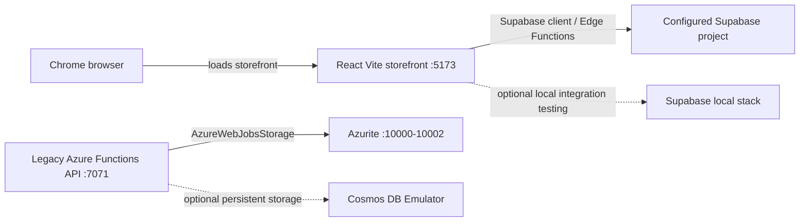

# Azure Debug Plan

> **Status:** Approved
> **Execution Mode:** Guided
> **Created:** 2026-10-20
> **Last Updated:** 2026-10-28

## Prerequisites

| Tool / Extension | Category | Service(s) | Installed | Version |
|------------------|----------|------------|-----------|---------|
| Node.js | Runtime | `storefront`, `legacy-api` | ✅ | v24.22.0 (storefront requires >=22.12.0) |
| npm | Package manager | `storefront`, `legacy-api` | ✅ | 11.19.1 |
| Chrome | Browser | `storefront` | ✅ | 156.0.8078.48 |
| Azure Functions Core Tools | Runtime | `legacy-api` | ✅ | 4.16.0 |
| `ms-azuretools.vscode-azurefunctions` | VS Code extension | `legacy-api` | ✅ | 1.22.2 |
| Docker | Container runtime | `legacy-api` (legacy), `supabase-local` (optional) | ❓ | 29.9.1 (Docker Desktop engine not reachable) |
| Docker Compose | Compose provider | `legacy-api` (legacy), `supabase-local` (optional) | ✅ | v5.6.0 |
| Supabase CLI | Local backend runtime | `supabase-local` | ❓ | Not detected in PowerShell PATH |
| Deno | Runtime | `supabase-functions` | ❓ | Not detected in PowerShell PATH |

> ⚠️ Docker Desktop's engine was not reachable during this scan. Start Docker Desktop before running emulator tasks; verify Supabase CLI and Deno if you intend to debug the local Supabase stack or Edge Functions.

> ℹ️ **Normal development does not require Docker, Azurite, Azure Functions, the Supabase CLI, or Deno.** The CLI and Deno are only needed for an explicitly requested local Supabase stack or direct Edge Function lint/debug work. Do not start containers as part of the normal storefront workflow.

## Active Development Path

React and Vite are the active frontend; Supabase is the active backend for Auth, PostgreSQL/RLS, Storage, and Edge Functions. The storefront uses the configured Supabase project directly and has no Azure Functions or `/api` dependency. Keep `api/`, `infra/`, `compose.yaml`, and their VS Code tasks as legacy/reference material; do not start or deploy them as part of normal development.

The standard commands are `npm.cmd run dev` to run the website and `npm.cmd run build` to build it. Configure `VITE_SUPABASE_URL` and `VITE_SUPABASE_PUBLISHABLE_KEY` in the local environment for live Supabase access. No database, product, order, Auth, policy, or migration state was changed during this planning update.

## Debug Configurations

| Generate | Debug Config Name | Service Label | Service Root | Project Type | Runtime | Version | Azure Dependencies |
|----------|--------------------|---------------|--------------|--------------|---------|---------|---------------------|
| [x] | Storefront (debug) | storefront | `.` | frontend-spa (Vite) | node-ts | `>=22.12.0` | — |
| [ ] | Supabase Edge Functions (local) | supabase-functions | `supabase/functions` | supabase-edge-functions | deno | Not pinned | — |
| [ ] | Legacy API (debug) | legacy-api | `api` | functions | node-ts | `>=22.12.0` | Azure Storage, Cosmos DB, Azure Blob Storage |
| [x] | Storefront + API (debug) | Storefront + Legacy API | — | *Compound Config* | — | — | — |

| Project Type | Description |
|-------------|-------------|
| frontend-spa (Vite) | Active React storefront served by Vite on port 5173. It calls Supabase directly and has no local `/api` proxy. |
| supabase-edge-functions | Active hosted Supabase Edge Functions. Local stack startup/debugging is optional and is not part of normal storefront development. |
| functions | Retained Node.js/TypeScript Azure Functions v4 API under `api/`; README identifies it as rollback/reference code, not the active storefront backend. |

> ℹ️ **Architecture note:** The storefront targets the configured Supabase project. The README documents that the repository migration and Edge Functions have not been applied/deployed. The legacy Azure API is not called by the storefront; its existing launch entry is retained for reference only.

## Orchestrator

| Orchestrator | Container Runtime | Compose Command | Description |
|-------------|-------------------|-----------------|-------------|
| Docker Compose | Docker | `docker compose` | Retained for legacy Azurite and explicitly requested local Supabase testing only; not used by the normal storefront workflow. |

## Emulators

| Dependent Service | Emulator | Purpose |
|-------------------|----------|---------|
| Azure Storage | Azurite | Legacy Azure Functions host state and optional legacy Blob Storage flows; not required by the active storefront. |
| Cosmos DB | Cosmos DB Emulator | Optional only for persistent legacy API testing; not present in the current `compose.yaml`. |
| Supabase PostgreSQL, Auth, Storage, and Edge Runtime | Supabase local stack | Optional local integration target for the active backend; requires Supabase CLI and Docker and is not part of normal development. |

## Architecture Diagram

## Migrations

| Generate | Service | Migration Tool |
|----------|---------|---------------|
| [ ] | supabase-local | Supabase SQL migrations under `supabase/migrations/`; local execution through Supabase CLI is not currently verified. Do not automatically rerun the existing initial migration against an existing database. The current SQL source requires review before any application; do not run it as part of this plan. |
| [ ] | legacy-api | Custom TypeScript Cosmos DB migration: `npm run migrate --workspace api` runs `api/src/migrations/001-create-store-container.ts` after the API build; requires `COSMOS_ENDPOINT`. |

## API Test Collections

| Generate | Service | Description |
|----------|---------|-------------|
| [ ] | supabase-functions | 

Edge Function HTTP endpoints
 POST `/functions/v1/create-order` POST `/functions/v1/upload-product-image` POST `/functions/v1/cloudinary-media` 
 |
| [ ] | legacy-api | 

Azure Functions HTTP endpoints
 GET `/api/products`; GET `/api/products/{id}`; GET `/api/categories`; GET `/api/store-config`; POST `/api/orders`; POST `/api/contact`; GET, POST `/api/admin/products`; POST `/api/admin/categories`; DELETE `/api/admin/categories/{id}`; GET, PATCH `/api/admin/store-config`; DELETE `/api/admin/products/{id}`; GET `/api/admin/orders`; PATCH `/api/admin/orders/{id}`; POST `/api/admin/images`; GET `/api/images/{name}`. Admin routes require Entra authentication and an authorized administrator. 
 |

## Convenience Scripts

No new scripts are proposed. Use `npm.cmd run dev` and `npm.cmd run build` for normal website development. `npm.cmd test` is available for tests. Existing Azure Functions and Azurite tasks remain unchanged for legacy/reference use; do not run them as part of the active workflow. Local Supabase commands are optional and require installing/reviewing the Supabase CLI first.
